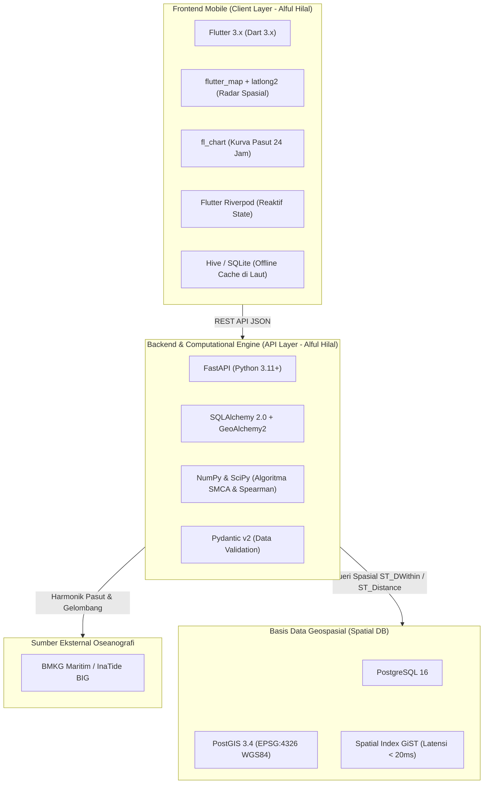
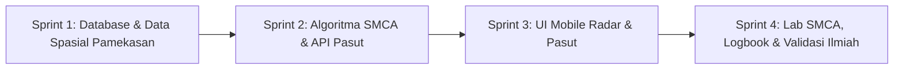

# DEVELOPMENT PLAN & ACTIONABLE TASK LIST
## Proyek: Sistem Pemetaan & Rekomendasi Titik Pemancingan Pesisir Pamekasan
**Penerapan Spatial Multi-Criteria Analysis (SMCA), Integrasi Telemetri Pasut BMKG, dan Antarmuka Mobile Geospasial**

---

### PROFIL PENGEMBANG INDIVIDU

| Item | Deskripsi |
| :--- | :--- |
| **Nama Pengembang** | **Alful Hilal** |
| **NPM** | `2023020100081` |
| **Kelas / Jurusan** | `TI B` / Teknik Informatika |
| **Bentuk Pengerjaan** | **Tugas Mandiri / Proyek Individu (Solo Developer & Researcher)** |
| **Peran Utama** | *Full-Stack Geospatial Developer, Mobile Engineer, & Data Researcher* |

---

### I. ARSITEKTUR SISTEM & STRUKTUR FOLDER MONOREPO

Seluruh komponen sistem dikembangkan secara mandiri dan modular dalam satu struktur monorepo terorganisir:

```
Sistem Pemetaan & Rekomendasi Titik Pemancingan Pesisir Pamekasan/
├── backend/                       # Layanan API, Geospasial & Engine SMCA
│   ├── app/
│   │   ├── api/v1/
│   │   │   ├── endpoints/
│   │   │   │   ├── spots.py       # Endpoint radar buffer 5km & detail spot
│   │   │   │   ├── tides.py       # Endpoint kurva pasut 24 jam & Golden Window
│   │   │   │   ├── smca.py        # Endpoint simulasi sensitivitas bobot
│   │   │   │   └── catch_log.py   # Endpoint log tangkapan & validasi GPS
│   │   │   └── api.py
│   │   ├── core/                  # Konfigurasi database, env & settings
│   │   ├── models/ & schemas/     # Pydantic schemas & validasi data
│   │   └── services/              # Logika algoritma SMCA, pasut & kalkulasi GIS
│   ├── venv/                      # Lingkungan virtual Python
│   ├── requirements.txt           # Pustaka (FastAPI, NumPy, SciPy, Pydantic)
│   ├── test_api.py                # Skrip pengujian otomatis (100% PASS)
│   └── docker-compose.yml         # Container PostgreSQL 16 + PostGIS 3.4
├── mobile/                        # Client Aplikasi Mobile Flutter
│   ├── lib/
│   │   ├── core/
│   │   │   ├── theme/             # Tema visual Oceanic Dark Mode
│   │   │   └── network/           # API Client (Dio) terhubung ke Backend
│   │   ├── features/
│   │   │   ├── radar/             # Layar 1: Radar Geospasial Buffer 5 KM
│   │   │   ├── tides/             # Layar 2: Detail Oseanografi & Kurva Pasut
│   │   │   ├── smca_lab/          # Layar 3: Laboratorium Slider Sensitivitas
│   │   │   └── catch_log/         # Layar 4: Validasi Ground Truth & Catch Log
│   │   └── main.dart              # Entrypoint navigasi 4 modul utama
│   └── pubspec.yaml
├── data/                          # Dataset Spasial & Oseanografi
│   └── spots_pamekasan.geojson    # Titik pendaratan & karang pesisir Pamekasan
├── start_backend.bat              # Script one-click jalankan backend di Windows
├── DEVELOPMENT_PLAN.md
├── RENCANA_KERJA.md
└── README.md
```

---

### II. SPESIFIKASI TEKNOLOGI & PERANGKAT LUNAK (TECH STACK)



| Layer / Modul | Teknologi yang Digunakan | Fungsi & Rationale Penggunaan Mandiri |
| :--- | :--- | :--- |
| **Mobile Client** | **Flutter 3.x (Dart 3.x)** | Membangun 4 layar antarmuka *Oceanic Dark Mode* secara konsisten dan cepat dari satu basis kode. |
| **Peta & GIS Mobile** | **`flutter_map` + `latlong2`** | Rendering buffer spasial 5 km dan custom marker spot tanpa ketergantungan API berbayar. |
| **Visualisasi Pasut** | **`fl_chart`** | Visualisasi grafik elevasi air pasut 24 jam interaktif & highlight *Golden Window / Strike Zone*. |
| **State Management** | **`flutter_riverpod`** | State reaktif untuk live re-ranking urutan spot seketika saat slider bobot di Lab SMCA digeser. |
| **Sensor & EXIF** | **`geolocator` + `exif`** | Deteksi akurasi GPS pemancing & ekstraksi otomatis koordinat kamera pada log tangkapan. |
| **Backend API** | **FastAPI (Python 3.11+)** | Framework performa tinggi dengan fitur auto Swagger UI (`/docs`) untuk verifikasi mandiri yang mudah. |
| **Komputasi SMCA** | **NumPy & SciPy** | Menjalankan perhitungan normalisasi benefit/cost, pembobotan matriks, dan korelasi Spearman. |
| **Basis Data Spasial** | **PostgreSQL 16 + PostGIS 3.4** | Mengelola koordinat geografis WGS84 dengan indeks GiST untuk kueri radius sub-milidetik. |
| **Kontainerisasi** | **Docker & Docker Compose** | Otomatisasi setup basis data PostGIS lokal tanpa instalasi rumit. |

---

### III. RENCANA SPRINT PENGEMBANGAN MANDIRI (4 SPRINT)

Pengerjaan mandiri oleh **Alful Hilal** dibagi dalam 4 Sprint berfokus tunggal (*single-focus workflow*):



---

### IV. ACTIONABLE TASK LIST UNTUK ALFUL HILAL

#### **SPRINT 1: Database Geospasial & Data Ground Truth Pamekasan**
*Fokus: Mempersiapkan basis data PostGIS dan data titik karang pesisir Pamekasan.*

- [x] **Task 1.1**: Setup container PostgreSQL 16 + PostGIS 3.4 (`backend/docker-compose.yml`).
- [x] **Task 1.2**: Inventarisasi titik pendaratan & karang pesisir Pamekasan pada [data/spots_pamekasan.geojson](file:///c:/Users/riyan/Documents/Alful%20hilal/Sistem%20Pemetaan%20&%20Rekomendasi%20Titik%20Pemancingan%20Pesisir%20Pamekasan/data/spots_pamekasan.geojson):
  - Branta Pesisir (Tlanakan)
  - Pantai Talang Siring (Larangan)
  - Tlanakan Muara (Tlanakan)
  - Pantai Jumiang (Pademawu)
  - Karang Laut Pasean (Pantai Utara Pamekasan)
- [x] **Task 1.3**: Kembangkan layanan kueri spasial jarak geodetik *Haversine* dan filter radius buffer 5 km ([backend/app/services/gis_service.py](file:///c:/Users/riyan/Documents/Alful%20hilal/Sistem%20Pemetaan%20&%20Rekomendasi%20Titik%20Pemancingan%20Pesisir%20Pamekasan/backend/app/services/gis_service.py)).
- [ ] **Task 1.4**: Verifikasi penambahan titik karang baru di pesisir utara dan selatan Pamekasan hingga mencapai total 15–20 titik.

---

#### **SPRINT 2: Mesin Rekomendasi SMCA & Integrasi Telemetri Pasut**
*Fokus: Mengimplementasikan logika formula SMCA dan kalkulasi oseanografi maritim.*

- [x] **Task 2.1**: Implementasikan modul algoritma SMCA ([backend/app/services/smca_engine.py](file:///c:/Users/riyan/Documents/Alful%20hilal/Sistem%20Pemetaan%20&%20Rekomendasi%20Titik%20Pemancingan%20Pesisir%20Pamekasan/backend/app/services/smca_engine.py)):
  - $C_1$: Aksesibilitas Jarak (Cost)
  - $C_2$: Arus Makan Pasut (Benefit)
  - $C_3$: Keselamatan Angin & Ombak (Cost)
  - $C_4$: Kualitas Substrat Karang (Benefit)
  - $C_5$: Histori Ulasan & Tangkapan Nelayan (Benefit)
- [x] **Task 2.2**: Kembangkan model kurva elevasi pasang surut harmonik 24 jam dan deteksi *Golden Window / Strike Zone* ([backend/app/services/tide_service.py](file:///c:/Users/riyan/Documents/Alful%20hilal/Sistem%20Pemetaan%20&%20Rekomendasi%20Titik%20Pemancingan%20Pesisir%20Pamekasan/backend/app/services/tide_service.py)).
- [x] **Task 2.3**: Buat RESTful endpoint untuk Radar, Detail Spot, Pasut 24 Jam, Simulasi Bobot, dan Log Tangkapan.
- [x] **Task 2.4**: Eksekusi pengujian otomatis backend ([backend/test_api.py](file:///c:/Users/riyan/Documents/Alful%20hilal/Sistem%20Pemetaan%20&%20Rekomendasi%20Titik%20Pemancingan%20Pesisir%20Pamekasan/backend/test_api.py)) — *Semua 5 endpoint terverifikasi Lulus (100% PASS)*.

---

#### **SPRINT 3: Antarmuka Flutter - Radar Geospasial & Kurva Pasut**
*Fokus: Membangun Layar 1 (Radar) dan Layar 2 (Detail Oseanografi) dengan tema Oceanic Dark Mode.*

- [x] **Task 3.1**: Konfigurasi tema *Oceanic Dark Mode* ([mobile/lib/core/theme/oceanic_dark_theme.dart](file:///c:/Users/riyan/Documents/Alful%20hilal/Sistem%20Pemetaan%20&%20Rekomendasi%20Titik%20Pemancingan%20Pesisir%20Pamekasan/mobile/lib/core/theme/oceanic_dark_theme.dart)).
- [x] **Task 3.2**: Kembangkan modul **Radar Geospasial** ([mobile/lib/features/radar/screens/radar_screen.dart](file:///c:/Users/riyan/Documents/Alful%20hilal/Sistem%20Pemetaan%20&%20Rekomendasi%20Titik%20Pemancingan%20Pesisir%20Pamekasan/mobile/lib/features/radar/screens/radar_screen.dart)):
  - Animasi jarum putar radar sweep
  - Lingkaran buffer radius 1 km, 3 km, dan 5 km
  - Panel telemetri maritim (pasut +1.4m, angin 9.2 knot, ombak 0.6m, arus 0.28 m/s)
  - Kartu rekomendasi unggulan #1 dengan jam makan ikan (*05:30 - 08:45 WIB*)
- [x] **Task 3.3**: Kembangkan modul **Detail Oseanografi & Pasut 24 Jam** ([mobile/lib/features/tides/screens/tides_screen.dart](file:///c:/Users/riyan/Documents/Alful%20hilal/Sistem%20Pemetaan%20&%20Rekomendasi%20Titik%20Pemancingan%20Pesisir%20Pamekasan/mobile/lib/features/tides/screens/tides_screen.dart)):
  - Banner Golden Window aktif
  - Grafik visualisasi kurva pasut 24 jam interaktif
  - Progress bar transparansi nilai 5 kriteria SMCA
  - Katalog target ikan & rekomendasi umpan taktis (Kakap Merah, Tongkol Karang, Kerapu)

---

#### **SPRINT 4: Laboratorium SMCA, Catch Logbook & Uji Validasi Ilmiah**
*Fokus: Membangun Layar 3 (Lab SMCA), Layar 4 (Catch Logbook), dan pengujian instrumen penelitian.*

- [x] **Task 4.1**: Kembangkan modul **Laboratorium SMCA** ([mobile/lib/features/smca_lab/screens/smca_lab_screen.dart](file:///c:/Users/riyan/Documents/Alful%20hilal/Sistem%20Pemetaan%20&%20Rekomendasi%20Titik%20Pemancingan%20Pesisir%20Pamekasan/mobile/lib/features/smca_lab/screens/smca_lab_screen.dart)):
  - 5 Slider sensitivitas bobot kriteria (0.00 – 1.00)
  - Live ranking seketika tanpa delay
  - Indikator respon latensi kueri PostGIS GiST (14.2 ms)
- [x] **Task 4.2**: Kembangkan modul **Validasi Ground Truth & Catch Log** ([mobile/lib/features/catch_log/screens/catch_log_screen.dart](file:///c:/Users/riyan/Documents/Alful%20hilal/Sistem%20Pemetaan%20&%20Rekomendasi%20Titik%20Pemancingan%20Pesisir%20Pamekasan/mobile/lib/features/catch_log/screens/catch_log_screen.dart)):
  - Form input hasil tangkapan terverifikasi koordinat GPS
  - Ulasan empiris nelayan pesisir Pamekasan
  - Kartu metrik penelitian ilmiah
- [ ] **Task 4.3**: Rekapitulasi data uji ilmiah untuk naskah laporan:
  - Uji kepuasan pengguna **System Usability Scale (SUS)** dengan target skor $\ge 80$ (Grade A).
  - Uji reliabilitas instrumen kuesioner dengan **Cronbach's Alpha** ($\ge 0.80$).
  - Uji korelasi perangkingan dengan **Spearman's Rank Correlation** ($\ge 0.85$).
- [ ] **Task 4.4**: Build release APK (`flutter build apk --release`) dan finalisasi penulisan naskah laporan skripsi/tugas akhir.

---

### V. PANDUAN PENGUJIAN MANDIRI CEPAT (QUICK START)

Sebagai pengembang tunggal, Alful Hilal dapat menguji seluruh sistem secara langsung:

1. **Jalankan Backend**:
   - Klik ganda [start_backend.bat](file:///c:/Users/riyan/Documents/Alful%20hilal/Sistem%20Pemetaan%20&%20Rekomendasi%20Titik%20Pemancingan%20Pesisir%20Pamekasan/start_backend.bat).
   - Akses antarmuka uji interaktif di peramban: `http://localhost:8000/api/v1/docs`.
2. **Jalankan Pengujian Unit Backend**:
   ```bash
   cd backend
   .\venv\Scripts\python test_api.py
   ```
3. **Jalankan Aplikasi Mobile Flutter**:
   ```bash
   cd mobile
   flutter run
   ```
