# RENCANA KERJA (WORK PLAN)
## Proyek: Sistem Pemetaan & Rekomendasi Titik Pemancingan Pesisir Pamekasan
**Penerapan Spatial Multi-Criteria Analysis (SMCA), Integrasi Telemetri Pasut BMKG, dan Antarmuka Mobile Geospasial**

---

### I. INFORMASI PROYEK & TIM PENGEMBANG

| Item | Deskripsi |
| :--- | :--- |
| **Judul Proyek** | Sistem Pemetaan & Rekomendasi Titik Pemancingan Pesisir Pamekasan Berbasis Mobile GIS dan SMCA |
| **Bidang / Program Studi** | Teknik Informatika (TI D) |
| **Durasi Proyek** | 16 Minggu (4 Bulan) |
| **Platform Target** | Mobile (Flutter Android/iOS) & Backend REST API (PostgreSQL + PostGIS) |
| **Lokasi Kajian** | Pesisir Kabupaten Pamekasan (Branta Pesisir, Talang Siring, Tlanakan, Jumiang, Pasean) |

#### Pengembang Mandiri (Solo Developer):
- **Nama**: **Alful Hilal**
- **NPM**: `2023020100081`
- **Program Studi / Kelas**: Teknik Informatika (`TI D`)
- **Peran**: *Full-Stack Geospatial Developer, Mobile Engineer & Peneliti Mandiri*

---

### II. TUJUAN & RUANG LINGKUP (SCOPE OF WORK)

#### 1. Tujuan Proyek
1. Mengembangkan aplikasi mobile geospasial berbasis Flutter dengan tema *Oceanic Dark Mode* untuk navigasi radar nelayan/pemancing.
2. Mengimplementasikan algoritma **Spatial Multi-Criteria Analysis (SMCA)** untuk perangkingan titik spot pemancingan berbasis multi-kriteria spasial & oseanografi.
3. Membangun basis data geospasial **PostgreSQL & PostGIS** dengan indexing **GiST (EPSG:4326)** yang mampu melakukan kueri buffer spasial dalam latensi sub-milidetik (<20 ms).
4. Mengintegrasikan telemetri maritim real-time (elevasi pasang surut, kecepatan arus makan, tinggi gelombang, arah/kecepatan angin).
5. Menyediakan fitur *Laboratorium SMCA* untuk analisis sensitivitas bobot dinamis serta validasi empiris (*Ground Truth & Catch Log*) dengan evaluasi SUS, Cronbach's Alpha, dan Spearman Rank Correlation.

#### 2. Ruang Lingkup Sistem
- **Modul 1: Radar Geospasial & Rekomendasi Spot** (Radius buffer 5 km, peta interaktif, spot ranking #1, navigasi instan).
- **Modul 2: Detail Oseanografi & Kurva Pasut 24 Jam** (Visualisasi pasang surut, deteksi *Golden Window / Strike Zone*, katalog ikan & rekomendasi umpan).
- **Modul 3: Laboratorium SMCA (Sensitivity Analysis)** (Slider bobot interaktif kriteria, live re-ranking, benchmark latensi kueri PostGIS GiST).
- **Modul 4: Validasi Ground Truth & Catch Logbook** (Input hasil tangkapan terverifikasi koordinat GPS, foto metadata, ulasan nelayan/angler lokal, instrumen SUS & validasi statistik).

---

### III. WORK BREAKDOWN STRUCTURE (WBS)

```mermaid
flowchart TD
    WBS["Sistem Pemetaan & Rekomendasi Titik Pemancingan"]
    
    WBS --> T1["Tahap 1: Inisiasi & Analisis Kebutuhan"]
    WBS --> T2["Tahap 2: Pengumpulan Data & Oseanografi"]
    WBS --> T3["Tahap 3: Perancangan Arsitektur & UI/UX"]
    WBS --> T4["Tahap 4: Pengembangan Backend & PostGIS"]
    WBS --> T5["Tahap 5: Pengembangan Frontend Flutter"]
    WBS --> T6["Tahap 6: Pengujian & Validasi Ilmiah"]
    WBS --> T7["Tahap 7: Deployment & Dokumentasi Akhir"]

    T1 --> T1_1["Studi Literatur SMCA & Pasut"]
    T1 --> T1_2["Penyusunan SRS & Use Case"]

    T2 --> T2_1["Survei Lapangan Pesisir Pamekasan"]
    T2 --> T2_2["Pipa Data Telemetri Pasut & Cuaca"]

    T3 --> T3_1["Desain Database Spasial PostGIS"]
    T3 --> T3_2["Desain UI/UX Oceanic Dark Mode"]

    T4 --> T4_1["REST API & Engine SMCA"]
    T4 --> T4_2["Optimasi Spasial Indexing GiST"]

    T5 --> T5_1["Radar Spasial & Peta Mapbox/OSM"]
    T5 --> T5_2["Grafik Pasut & Lab Slider SMCA"]

    T6 --> T6_1["Uji Fungsional & Black Box"]
    T6 --> T6_2["Uji SUS, Spearman & Cronbach Alpha"]

    T7 --> T7_1["Build APK Release & Hosting API"]
    T7 --> T7_2["Laporan Skripsi/Tugas Akhir"]
```

---

### IV. DETAIL TAHAPAN PELAKSANAAN KERJA

#### **Tahap 1: Inisiasi, Analisis Kebutuhan & Riset Ilmiah (Minggu 1 - 2)**
- **1.1 Studi Pustaka & Formulasi Algoritma SMCA**:
  - Penentuan kriteria pembobotan (Jarak aksesibilitas dari dermaga, elevasi pasut/arus makan, kecepatan angin, tinggi ombak, tipe substrat karang, histori tangkapan).
  - Standarisasi formula normalisasi matriks dan pembobotan kriteria SMCA.
- **1.2 Analisis Kebutuhan Sistem (SRS)**:
  - Definisi kebutuhan fungsional & non-fungsional.
  - Perancangan Use Case Diagram, Activity Diagram, dan Sequence Diagram.
- **1.3 Kickoff Proyek & Setup Environment**:
  - Inisialisasi Git repository (GitHub/GitLab) dengan Git Flow (`main`, `develop`, `feature/*`).
  - Standarisasi tools: Flutter SDK, PostgreSQL 16 + PostGIS 3.4, Docker/API Framework (FastAPI / Express / Laravel).

#### **Tahap 2: Pengumpulan Data Lapangan & Telemetri Oseanografi (Minggu 3 - 4)**
- **2.1 Survei Ground Truth Titik Karang Pesisir Pamekasan**:
  - Inventarisasi koordinat GPS titik pemancingan utama:
    - *Branta Pesisir* (Kec. Tlanakan)
    - *Pantai Talang Siring* (Kec. Larangan)
    - *Pantai Jumiang* (Kec. Pademawu)
    - *Perairan Pasean / Batu Marmar* (Pantai Utara Pamekasan)
  - Identifikasi jenis substrat dasar laut (karang tubir, pasir berbatu, rumput laut/mangrove) dan spesies dominan (Kakap Merah, Kerapu, Tongkol, Baronang).
- **2.2 Pengadaan & Pemodelan Data Telemetri BMKG**:
  - Koleksi data pasut perairan Selat Madura & Laut Jawa (tabel harmonik atau API maritim).
  - Skrip pengambil data cuaca maritim (kecepatan angin knots, arah gelombang, tinggi gelombang signifikan).

#### **Tahap 3: Perancangan Desain Sistem & Basis Data Spasial (Minggu 5 - 6)**
- **3.1 Perancangan Basis Data Geospasial (PostGIS)**:
  - Skema tabel relasional: `fishing_spots`, `spot_substrates`, `telemetry_logs`, `catch_logs`, `criteria_weights`, `users`.
  - Penambahan kolom geometri `geom geometry(Point, 4326)` dengan indexing `USING GIST(geom)`.
- **3.2 Perancangan UI/UX Mobile (Figma Prototype)**:
  - Konsep tema: *Oceanic Dark Mode* (Deep Navy `#0A1128`, Neon Cyan `#00E5FF`, Safety Amber `#FFB300`).
  - Wireframing & Prototyping 4 Layar Utama:
    1. Layar Radar Geospasial (Peta interaktif + buffer 5 km).
    2. Layar Detail Oseanografi & Kurva Pasut 24 Jam (*Strike Zone Chart*).
    3. Layar Laboratorium SMCA (Slider bobot interaktif).
    4. Layar Validasi Ground Truth & Catch Logbook.

#### **Tahap 4: Pengembangan Backend API & Mesin SMCA (Minggu 7 - 9)**
- **4.1 Arsitektur Backend & Spatial API**:
  - Pembuatan endpoint RESTful:
    - `GET /api/v1/spots/radar?lat={}&lng={}&radius=5000` (Kueri PostGIS `ST_DWithin` & `ST_Distance`).
    - `GET /api/v1/spots/{id}/tide-curve` (Elevasi pasut 24 jam & prediksi Golden Window).
    - `POST /api/v1/smca/calculate` (Kalkulasi ulang skor SMCA berdasarkan bobot kustom).
    - `POST /api/v1/catch-log` (Upload tangkapan dengan koordinat GPS & foto).
- **4.2 Implementasi Engine SMCA**:
  - Algoritma normalisasi nilai kriteria (benefit vs cost criteria).
  - Perhitungan matriks skor komposit spasial per spot di dalam radius buffer pengguna.
- **4.3 Pengujian Latensi Kueri PostGIS GiST**:
  - Benchmark kueri spasial radius buffer dengan indeks GiST vs Sequential Scan (< 20 ms).

#### **Tahap 5: Pengembangan Aplikasi Mobile Flutter (Minggu 9 - 12)**
- **5.1 Integrasi Peta Geospasial & Radar**:
  - Pemanfaatan `flutter_map` / `mapbox_gl` / `google_maps_flutter` dengan styling dark/satellite.
  - Implementasi radar buffer 5 km dinamis dari lokasi GPS pengguna.
  - Penanda spot interaktif dengan indikator skor kelayakan (0.00 - 1.00).
- **5.2 Modul Kurva Pasut & Golden Window**:
  - Visualisasi grafik garis interaktif (menggunakan `fl_chart`) untuk elevasi air (-2m hingga +2m).
  - Penandaan zona *Strike Zone* (jam makan aktif saat arus bergerak).
- **5.3 Modul Laboratorium SMCA**:
  - Pembuatan komponen interaktif *Weight Slider* untuk 5 kriteria.
  - Mekanisme reaktif (*state management* misal Riverpod / Bloc / Provider) untuk live re-ranking tanpa lag.
- **5.4 Modul Catch Logbook & Ground Truth**:
  - Form upload tangkapan: deteksi otomatis GPS EXIF metadata foto, pilihan spesies ikan, berat (kg), umpan yang digunakan.

#### **Tahap 6: Pengujian Sistem & Validasi Ilmiah (Minggu 13 - 14)**
- **6.1 Pengujian Perangkat Lunak**:
  - *Unit Testing* & *Integration Testing* API SMCA.
  - *Black-Box Testing* antarmuka mobile Flutter pada berbagai perangkat Android.
- **6.2 Pengujian Kinerja Komputasi**:
  - Pengujian performa kueri PostGIS GiST (mengukur latency 14.2 ms vs non-index).
- **6.3 Validasi Ilmiah & Uji Penerimaan Pengguna**:
  - Pengujian korelasi peringkat empiris nelayan vs output SMCA menggunakan **Spearman Rank Correlation** (target: $\rho \ge 0.85$).
  - Uji reliabilitas instrumen dengan **Cronbach's Alpha** (target: $\alpha \ge 0.80$).
  - Pengujian kegunaan (*usability*) dengan **System Usability Scale (SUS)** kepada komunitas pemancing dan nelayan pesisir Pamekasan (target: skor $\ge 80$ / Grade A).

#### **Tahap 7: Deployment, Dokumentasi & Finalisasi (Minggu 15 - 16)**
- **7.1 Deployment Infrastruktur**:
  - Deployment backend & PostgreSQL PostGIS ke Cloud VPS / Server lokal kampus.
  - Build Release APK Flutter Android.
- **7.2 Penyusunan Laporan & Dokumentasi Teknis**:
  - Penulisan naskah Laporan Akhir / Skripsi (BAB I - BAB V).
  - Penyusunan User Manual (Buku Panduan Pengguna) dan dokumentasi API (Swagger/Postman).
- **7.3 Persiapan Demo & Presentasi Sidang**:
  - Pembuatan video simulasi aplikasi.
  - Gladi resik presentasi pengujian sistem dan paparan hasil temuan.

---

### V. JADWAL KERJA (TIMELINE GANTT CHART - 16 MINGGU)

| No | Aktivitas / Tahapan Kerja | M1-2 | M3-4 | M5-6 | M7-8 | M9-10 | M11-12 | M13-14 | M15-16 |
|---|---|:---:|:---:|:---:|:---:|:---:|:---:|:---:|:---:|
| **1** | **Inisiasi & Analisis Kebutuhan** | [████] | | | | | | | |
| 1.1 | Studi literatur SMCA & oseanografi | [██] | | | | | | | |
| 1.2 | Penyusunan SRS, Use Case & Arsitektur | | [██] | | | | | | |
| **2** | **Pengumpulan Data Lapangan** | | [████] | | | | | | |
| 2.1 | Survei titik spot (Branta, Talang Siring, dll.) | | [██] | | | | | | |
| 2.2 | Koleksi data pasut & telemetri maritim BMKG | | | [██] | | | | | |
| **3** | **Perancangan Sistem & UI/UX** | | | [████] | | | | | |
| 3.1 | Desain Database Spasial PostGIS (EPSG:4326) | | | [██] | | | | | |
| 3.2 | Desain UI/UX Figma (Oceanic Dark Mode) | | | | [██] | | | | |
| **4** | **Pengembangan Backend & Engine SMCA** | | | | [████] | [██] | | | |
| 4.1 | Pembuatan REST API Geospasial | | | | [██] | [██] | | | |
| 4.2 | Implementasi Algoritma SMCA & Pasut Logic | | | | | [██] | | | |
| 4.3 | Optimasi & Benchmark GiST Indexing | | | | | | [██] | | |
| **5** | **Pengembangan Frontend Mobile Flutter** | | | | | [████] | [████] | | |
| 5.1 | Integrasi Radar Geospasial & Mapbox/OSM | | | | | [██] | [██] | | |
| 5.2 | Modul Kurva Pasut 24h & Strike Zone | | | | | | [██] | | |
| 5.3 | Modul Laboratorium SMCA (Slider Bobot) | | | | | | [██] | [██] | |
| 5.4 | Modul Catch Logbook & Metadata GPS Foto | | | | | | | [██] | |
| **6** | **Pengujian & Validasi Ilmiah** | | | | | | | [████] | |
| 6.1 | Unit Testing, Blackbox Testing & Bug Fixing | | | | | | | [██] | |
| 6.2 | Uji Validasi SUS, Cronbach Alpha & Spearman | | | | | | | | [██] |
| **7** | **Deployment & Dokumentasi Akhir** | | | | | | | | [████] |
| 7.1 | Deployment VPS Backend & Build APK Release | | | | | | | | [██] |
| 7.2 | Finalisasi Laporan Akhir & Demo Sidang | | | | | | | | [████] |

---

### VI. ALOKASI TUGAS & TANGGUNG JAWAB PENGERJAAN MANDIRI

Karena proyek ini merupakan **tugas mandiri / pekerjaan individu oleh Alful Hilal**, seluruh domain teknis dan riset ilmiah dipegang secara terpadu:

| Domain Pekerjaan | Komponen Teknis yang Dikerjakan Mandiri | Target Luaran (Deliverable) |
| :--- | :--- | :--- |
| **Analisis & Riset** | Formulasi matematis SMCA, integrasi pasut BMKG, penyusunan SRS | Dokumen spesifikasi sistem & perumusan bobot |
| **Data Lapangan** | Inventarisasi titik karang pesisir Pamekasan (Branta, Talang Siring, dll.) | Berkas GeoJSON valid & koordinat WGS84 |
| **Backend & PostGIS** | Perancangan skema PostGIS, kueri buffer 5km `ST_DWithin`, REST API FastAPI | Server API aktif & kueri GiST responsif (<20ms) |
| **Engine SMCA** | Algoritma normalisasi benefit/cost & kalkulasi peringkat komposit | Modul kalkulasi bobot & uji Spearman |
| **Mobile Flutter** | Antarmuka Oceanic Dark Mode, visualisasi radar 5km, kurva pasut 24h, Lab SMCA | Aplikasi Flutter terhubung penuh ke API |
| **Pengujian & Validasi** | Uji unit testing backend, korelasi Spearman, reliabilitas Cronbach, dan SUS | Laporan uji empiris & validasi nelayan |
| **Dokumentasi & Laporan**| Penulisan naskah lengkap BAB I s.d. BAB V Skripsi/Tugas Akhir | Naskah laporan akhir & slide presentasi |

#### Rincian Fokus Tanggung Jawab Alful Hilal:
1. **Frontend Mobile & UI/UX**:
   - Membangun seluruh antarmuka aplikasi Flutter dengan tema *Oceanic Dark Mode*.
   - Mengimplementasikan visualisasi radar geospasial, kurva pasang surut 24 jam interaktif, dan slider sensitivitas bobot SMCA.
2. **Backend, Basis Data & Algoritma Spasial**:
   - Mengembangkan RESTful API dengan FastAPI dan PostgreSQL + PostGIS 3.4.
   - Mengoptimalkan kueri geospasial radius buffer 5 km menggunakan indeks GiST.
   - Menulis logika komputasi SMCA dan model harmonik pasang surut perairan Pamekasan.
3. **Pengumpulan Data & Uji Validasi Ilmiah**:
   - Menghimpun koordinat titik karang pesisir Pamekasan dan data telemetri pasut BMKG.
   - Melakukan pengujian kepuasan pengguna dengan instrumen *System Usability Scale* (SUS), korelasi *Spearman Rank*, dan reliabilitas *Cronbach's Alpha*.

---

### VII. MANAJEMEN RISIKO (RISK MANAGEMENT & MITIGATION)

| Risiko Teridentifikasi | Dampak | Probabilitas | Rencana Mitigasi (Pencegahan & Solusi) |
| :--- | :---: | :---: | :--- |
| **1. Ketiadaan API real-time publik BMKG maritim yang stabil** | Tinggi | Sedang | Membuat modul *fallback / parser* data pasang surut harmonik lokal Pamekasan atau scraping berkala yang disimpan dalam cache database lokal. |
| **2. Titik karang laut minim sinyal internet (Blank Spot)** | Tinggi | Sedang | Mengimplementasikan fitur *Offline-First* pada Flutter (caching data titik spot & kurva pasut harian ke SQLite/Isar lokal sebelum pengguna melaut). |
| **3. Akurasi GPS bergeser di tengah perairan laut** | Sedang | Rendah | Menggunakan filter akurasi GPS pada Flutter (`desiredAccuracy: LocationAccuracy.high`) dan toleransi jarak threshold. |
| **4. Kueri spasial radius melambat seiring bertambahnya data** | Sedang | Rendah | Memastikan penggunaan indeks spasial `GIST(geom)` pada PostGIS dan hanya mengambil atribut esensial saat kueri radar 5 km. |
| **5. Subjektivitas ulasan nelayan pada Ground Truth** | Sedang | Sedang | Menerapkan validasi otomatis: ulasan hasil tangkapan wajib menyertakan koordinat GPS yang sesuai dengan radius titik karang dan foto ber-metadata EXIF. |

---

### VIII. TARGET DELIVERABLES (LUARAN PROYEK)

1. **Aplikasi Mobile (Android APK)**:
   - Aplikasi siap pasang dengan fitur Radar Geospasial, Kurva Pasut 24 Jam, Lab SMCA, dan Catch Log.
2. **Source Code & Basis Data**:
   - Repository kode sumber Flutter Frontend dan Backend API.
   - Dump basis data PostgreSQL + PostGIS berisi data spasial spot pesisir Pamekasan.
3. **Dokumentasi Ilmiah & Laporan**:
   - Dokumen SRS (*Software Requirements Specification*) & SDD (*Software Design Document*).
   - Laporan Lengkap Skripsi/Tugas Akhir (BAB I s.d. BAB V).
   - Laporan Hasil Uji Validasi (Skor SUS $\ge 80$, Spearman $\ge 0.85$, Cronbach Alpha $\ge 0.80$).
4. **Media Presentasi & Video Demo**:
   - Slide presentasi interaktif dan video demonstrasi operasional aplikasi di pesisir Pamekasan.
